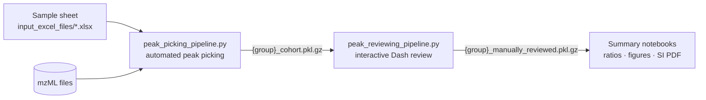

# LCMS_RiPP

Analysis code for detecting and quantifying post-translational modifications of
ribosomally synthesised and post-translationally modified peptides (RiPPs) from
LC-MS/MS data. The pipeline digests each precursor sequence *in silico*, extracts
ion chromatograms for the unmodified and modified fragments across biological
replicates, picks and scores peaks automatically, supports interactive manual
curation, and summarises the results as modification ratios, sequence-alignment
bar charts and supplementary-information (SI) reports.

> **Status:** research code accompanying a manuscript in preparation. The citation
> will be added on publication; see [`CITATION.cff`](CITATION.cff).

---

## Workflow



1. **Peak picking** (`peak_picking_pipeline.py`): for every experimental group in
   the sample sheet, parse and cache each replicate's mzML, generate target
   fragments (unmodified + every listed modification state), extract EICs, cluster
   candidate peaks across replicates (DBSCAN), and score each candidate by MS1
   isotope-pattern fit, mass error and MS2 fragment coverage. Replicates without a
   detectable peak get an empty "stub" so every replicate stays represented.
2. **Manual review** (`peak_reviewing_pipeline.py`): a local Dash web app showing
   one column per replicate for each target/charge. Pick among the candidates, or
   redraw the RT window and re-score it live. Saves one curated
   `{group}_manually_reviewed.pkl.gz` per group; re-opening resumes from it.
3. **Summaries** (notebooks): build a long-form table from all curated groups,
   choose the best cut/charge per group, compute modification ratios / apparent
   ΔΔG, draw the alignment + bar-chart figures, and render the SI PDF.

## Repository layout

| Path | Contents |
|------|----------|
| `peak_picking_pipeline.py` | CLI, step 1: automated peak picking per group. |
| `peak_reviewing_pipeline.py` | CLI, step 2: interactive peak review dashboard. |
| `pipeline_functions.py` | EIC extraction, cross-replicate clustering, peak construction and scoring. |
| `classes_spectrometry.py` | `MassSpectrum` (mzML parsing, noise filtering, caching) and `MSExperiment` (sample metadata). |
| `peptide_classes.py` | `TargetPeptide`, `PeptideFragment`, `PeptidePeak` (integration, MS1/MS2 validation, plots). |
| `peptide_functions.py` | In-silico digestion and numerical helpers. |
| `analysis_containers.py` | `AnalysisResults`, `ReplicateGroupResults`, `GroupedExperiments` (aggregation, SI figures). |
| `plotting_analysis_functions.py` | Cross-group tables, ratios/ΔΔG, MUSCLE alignments, figure and SI-report helpers. |
| `modification_dictionary.py` | Residue compositions, including the custom modification codes. |
| `flask_analysis_summaries.ipynb` | Flask-scale expression experiments: figures and SI report. |
| `plate_analysis_summaries.ipynb` | 96-well plate screens (point mutants, Rosetta designs). |
| `plot_peptide_alignments.ipynb` | Stand-alone sequence-alignment figures. |
| `input_excel_files/` | Sample sheets describing every LC-MS run analysed. |
| `legacy/` | Superseded scripts kept for provenance (see [`legacy/README.md`](legacy/README.md)). |

> The core modules sit at the top level on purpose. Saved result pickles store
> class references by module name (for example `analysis_containers.ReplicateGroupResults`),
> so moving these files into a package would stop existing results from loading.

## Installation

```bash
conda env create -f environment.yml
conda activate lcms
```

or with pip (Python 3.12):

```bash
pip install -r requirements.txt
```

**MUSCLE 5** is required only for the alignment figures. Download it from
<https://drive5.com/muscle5/> and either put it on your `PATH` as `muscle`, or
set `MUSCLE_EXE` to the executable's full path. Without it, the figures fall
back to unaligned sequences.

## Usage

Run every command from the repository root.

```bash
# 1. Automated peak picking -> <output_dir>/<group>/<group>_cohort.pkl.gz
python peak_picking_pipeline.py -i input_excel_files/flask_expressions.xlsx -o reports/flasks

# 2. Interactive review (opens on http://127.0.0.1:8051)
python peak_reviewing_pipeline.py -i input_excel_files/flask_expressions.xlsx -r reports/flasks
```

`peak_picking_pipeline.py` options: `--force_reload` re-parses the mzML files
instead of using the cached spectra; `--force_reanalyze` re-runs peak picking
even if a cohort file already exists. `peak_reviewing_pipeline.py` options:
`--port` and `--max_ppm` (the mass-error cutoff for listing a candidate,
default 15 ppm).

Then open the summary notebooks and point `REPORTS_PATH` in their configuration
cell at your reports directory.

Parsed spectra are cached next to each sample's outputs (`*_ms1.pkl` and
similar). Parsing a full run is slow and memory-hungry (several hundred MB per
sample), so later runs reuse the cache.

## Sample sheet format

Each row of the sample sheet is one LC-MS run. Rows that share
`experiment_id, precursor_plasmid, maturase_name, maturase_plasmid,
expression_temperature, digestion` form one experimental group, i.e. the
biological replicates analysed together.

| Column | Required | Description |
|--------|:-:|-------------|
| `sample_id` | ✓ | Unique sample identifier. |
| `experiment_id` | ✓ | Experiment/series name (e.g. `point_mutants`). |
| `precursor_plasmid`, `precursor_name` | ✓ | Precursor construct ID and descriptive name. |
| `maturase_plasmid`, `maturase_name` | ✓ | Modifying-enzyme construct. |
| `expression_temperature` | ✓ | Expression temperature (°C); part of the group key. |
| `digestion` | ✓ | Protease: `TEV`, or a pyteomics rule name such as `trypsin` or `glutamyl endopeptidase`. |
| `input_mzml_folder`, `input_mzml` | ✓ | Folder and file name of the run's mzML. |
| `output_folder_name` | ✓ | Per-sample folder for caches and per-replicate results. |
| `peptide_sequence` | ✓ | Full precursor sequence (`*` stop codons are stripped). |
| `core_start`, `core_end` |  | Core-peptide coordinates. Only digest fragments overlapping the core are targeted (`0` = no limit). |
| `modified_sequences` |  | Comma-separated modified sequences, using the custom residue codes in `modification_dictionary.py` (e.g. `GGCGPDPxVGVILPWA`). |
| `modifications` |  | One label per modified sequence, e.g. `("spliced", 1)` or `[("spliced", 1), ("retroaldol", 1)]`. |
| others |  | Free-form metadata (`date`, `instrument`, `host_strain`, `culture_medium`, …), carried through to the results. |

The sheets in `input_excel_files/` contain the absolute data paths used for the
original analysis (`D:\Spliceotide_Data_Analysis\...`). Change
`input_mzml_folder` and `output_folder_name` to match your copy of the data.
For results that already exist,
`ReplicateGroupResults.repoint_storage_root(old_root, new_root)` rewrites the
stored paths in memory.

## Data availability

The raw LC-MS data (mzML), the parsed-spectrum caches and the curated result
pickles are too large for this repository. They will be deposited separately;
the accession will be added here on publication.

## License

Released under the [MIT License](LICENSE).
